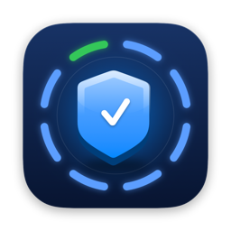
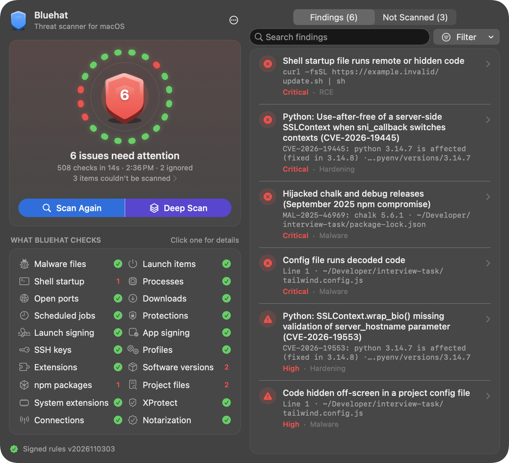
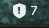
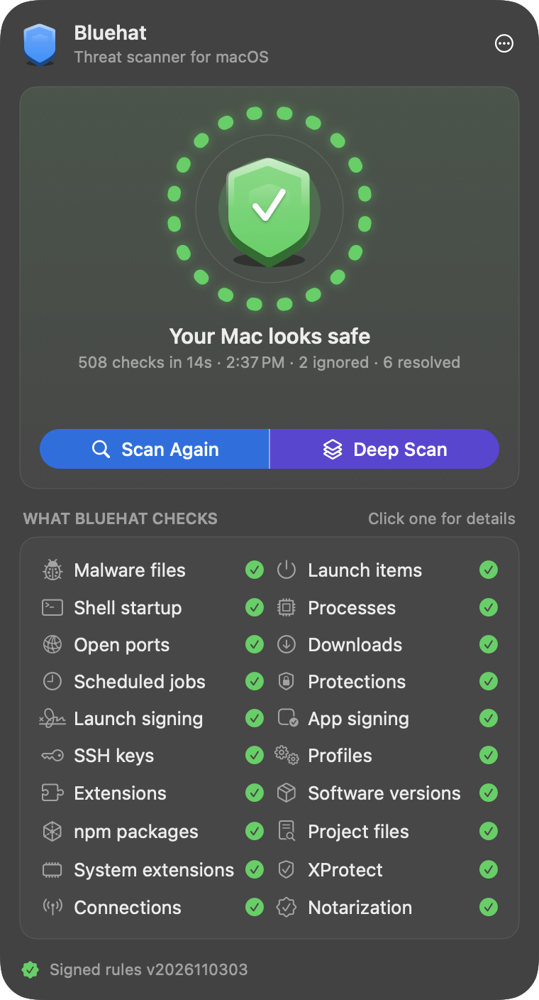
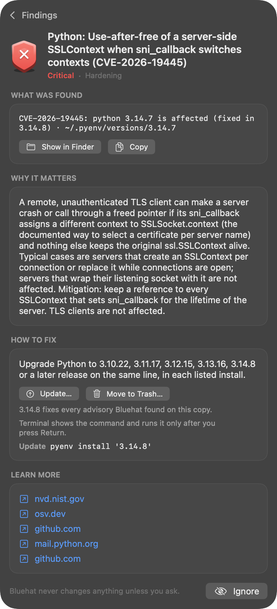
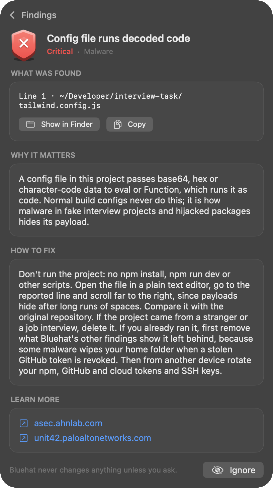
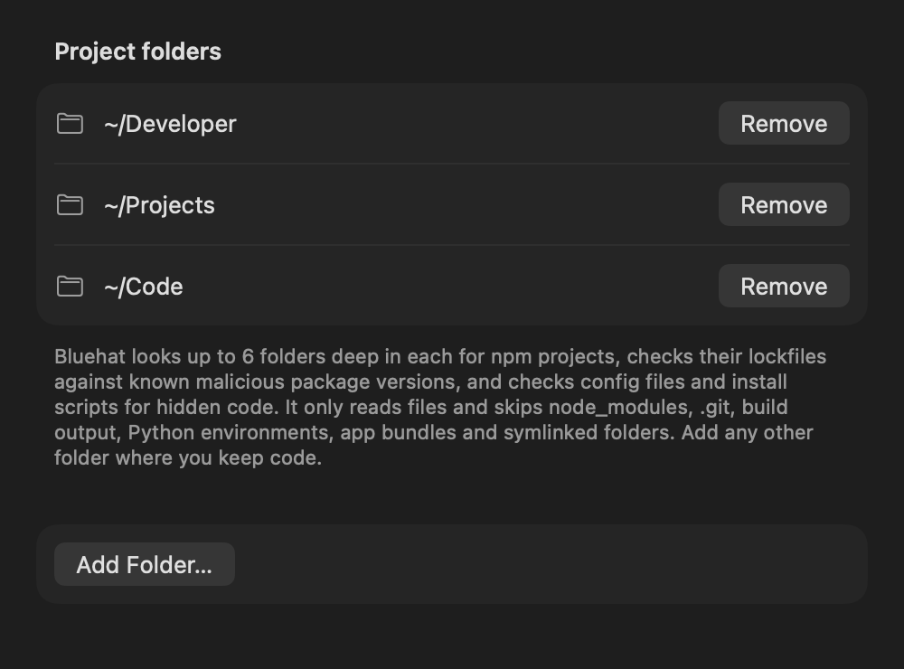
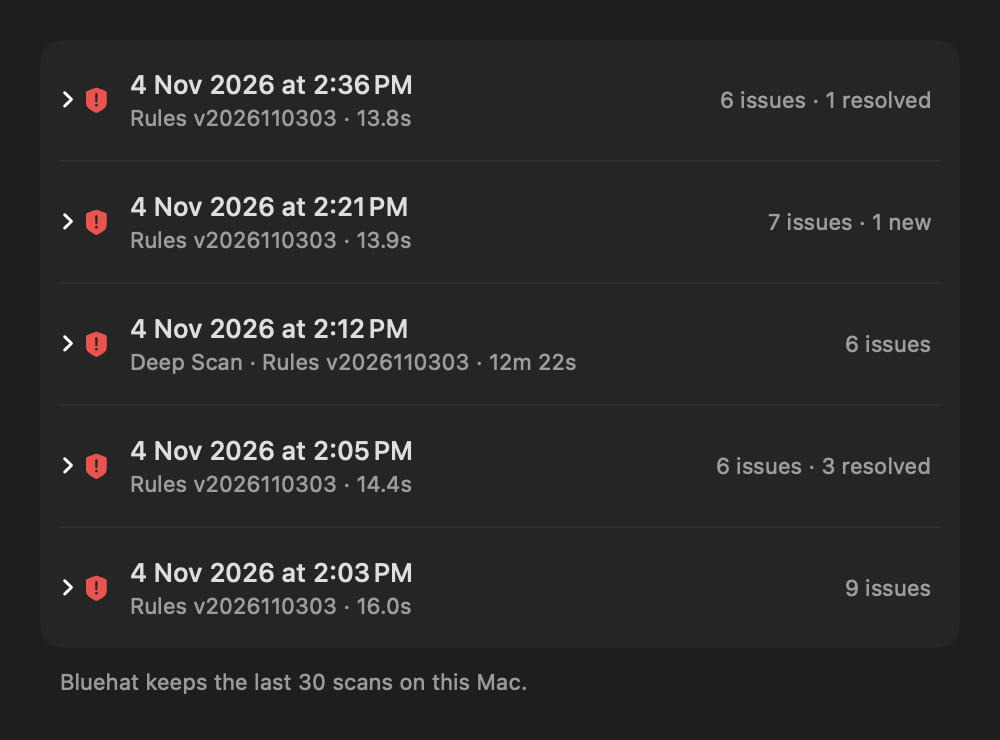
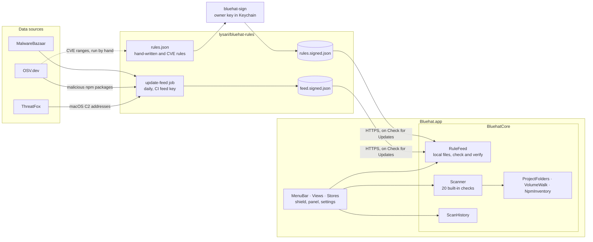

<p align="center">
  
</p>

<h1 align="center">Bluehat</h1>

<p align="center">
  <b>A menu bar threat scanner for macOS</b><br>
  Finds stealers, backdoors, poisoned npm projects and vulnerable dev tools, with signed rules that can't run code.
</p>

<p align="center">
  
  
  <a href="LICENSE"></a>
  <a href="https://github.com/lysari/bluehat-rules"></a>
  <a href="https://github.com/lysari/bluehat/releases/latest"></a>
</p>

<p align="center">
  <a href="#features">Features</a> ·
  <a href="#showcase">Showcase</a> ·
  <a href="#privacy-and-safety">Privacy</a> ·
  <a href="#install">Install</a> ·
  <a href="#build-from-source">Build</a> ·
  <a href="#architecture">Architecture</a> ·
  <a href="ROADMAP.md">Roadmap</a> ·
  <a href="#contributing">Contributing</a>
</p>

<p align="center">
  
</p>

---

## Why Bluehat

A lot of Mac malware doesn't need an exploit. It needs you to run one thing:
a cracked app, a `curl | sh` line, or `npm install` in a repository a "recruiter"
sent you. Bluehat looks for what that leaves behind:

- **Stealers and backdoors**, such as AMOS (Atomic Stealer), by their files,
  processes, launch items, file hashes and connections to their servers.
- **Persistence**: launch items, shell startup lines and cron jobs that bring
  malware back after a restart.
- **npm supply-chain attacks**: hijacked package releases in your lockfiles, and
  code hidden in the config files of fake job interview repositories.
- **Vulnerable developer tools**: old Node.js, Python, PHP, Ruby, Git and OpenSSL
  installs with known CVEs.

Bluehat only reads. It changes nothing unless you click a button and confirm, and
its rules are signed data, not code: a hacked rules repository can't make the app
run anything.

## Features

### What it checks

| | |
| --- | --- |
| 🐞 **Malware files** | Files and folders that known malware leaves behind, from published reports. |
| 🔁 **Launch items** | Programs and arguments of LaunchAgents and LaunchDaemons that match malware patterns. |
| 🐚 **Shell startup** | Lines in `~/.zshrc`, `~/.bashrc` and other startup files that pipe a download into a shell, decode hidden code or inject a library. |
| ⚙️ **Processes** | Command lines of running processes that match stealer, backdoor and miner behaviour. |
| 🌐 **Open ports** | Listening TCP ports used by known backdoors and miners. |
| ⬇️ **Downloads** | SHA-256 of files in Downloads, Desktop, `/Users/Shared` and `/private/tmp` against a feed of current macOS malware, rebuilt daily and updated when you accept it in Settings › Rules. |
| ⏰ **Scheduled jobs** | Cron jobs that download or decode code and run it. |
| 🛡️ **Protections** | System Integrity Protection, Gatekeeper and the firewall, when switched off. |
| ✍️ **Launch signing** | Programs started by launch items that are unsigned, ad-hoc signed or tampered with. |
| 📦 **App signing** | Apps in Applications and Downloads that are unsigned, ad-hoc signed or changed after signing. |
| 🏅 **Notarization** | Apps signed with a Developer ID that Apple never notarized (scanned for malware). Checked offline from the app's ticket where macOS has one; other new or changed apps are asked of Gatekeeper, a few per scan, and the answer is remembered until the app changes. |
| 🔑 **SSH keys** | Every key in `~/.ssh/authorized_keys`. Ignore the ones you know, and only new ones come back. |
| 🧾 **Profiles** | Configuration profiles that set a proxy, DNS, root certificate, content filter or browser policy. |
| 🧩 **Extensions** | Chrome, Brave, Edge, Arc, Chromium, Vivaldi and Firefox extensions from outside the official stores, with cookie access on every site, debugger or proxy permissions, or listed in published hijack and spyware campaign reports. |
| 🧰 **Software versions** | Node.js, Python, PHP, Ruby, Git and OpenSSL installs (Homebrew, nvm, Volta, fnm, asdf, mise, pyenv, rbenv, python.org, the Node.js installer) with known CVEs. **Update** opens Terminal with the upgrade command, or the download page for an installer copy; **Move to Trash** removes a version-manager copy, and **Remove** opens Terminal with `brew` for a Homebrew one. |
| 📚 **npm packages** | Known-malicious package versions in the lockfiles of your projects and in global `node_modules`, such as the hijacked chalk and debug releases and the Shai-Hulud worm. |
| 🕵️ **Project files** | Code hidden in `tailwind.config.js`, `next.config.js` and other config files, and install scripts that download and run code, as fake interview repositories do. |
| 🧱 **System extensions** | System extensions (VPNs, network filters, endpoint security, drivers) and loaded third-party kernel extensions that aren't from a short list of well-known vendors. |
| 🦠 **XProtect** | Apple's built-in malware definitions, when they are older than the version the rules expect. |
| 📡 **Connections** | Open TCP and UDP connections from any process to the command-and-control servers of current macOS malware and of attack frameworks such as Cobalt Strike and Sliver, from a daily ThreatFox feed, with the process name. |

### The app

| | |
| --- | --- |
|  | **Menu bar count**: the shield shows scan progress, then the number of open issues. |
| 🪟 **Floating panel** | One click on the shield opens the scan panel, which stays above other windows until you click again. To let other windows cover it, turn off the switch in Settings › General; the shield then brings it back to the front. |
| 🧭 **Live checks grid** | During a scan a spinner marks the check running now, and a Deep Scan adds a Disk walk row with its live count. Click any check, at any time, for what it looks for, where it looks, what a finding means, and whether it reads file contents or reaches the internet. |
| 🔍 **Finding details** | What was found, why it matters, how to fix it, and source links for every finding. |
| 🗂️ **Findings list** | One list sorted by severity, or grouped by check area with a count on each group. Choose in Settings › General. A group expands and collapses with a click, and every group opens again on each new scan result, so a new threat is never hidden. Each group's **⋯** menu offers **Copy Fix Steps**, **Ignore All** and, for Software versions, **Move All to Trash**. There is no Fix All, on purpose. Search as you type and a filter menu narrow the list by severity and check type; a group's actions then act only on the findings shown, and say how many. |
| 🚧 **Not Scanned** | A tab beside the findings lists what a scan knows it didn't check: folders it couldn't open, files over a limit, cloud-only files, launch items it couldn't parse, checks that timed out and more, grouped by a plain reason with your home folder first, each with Show in Finder. A calm line in the status card opens it, and "Your Mac looks safe" stays as it is, unless a Deep Scan stopped at its memory limit. The list covers the latest scan and isn't saved. |
| ✅ **Signed rules you review** | Hand-written rules and a malware fingerprint feed ship inside the app and are verified with Ed25519 every time they load. Settings › Rules checks for updates when you click, compares them with your local copy, and changes nothing until you accept. |
| 🔬 **Deep Scan** | **Deep Scan…**, the right half of the Scan Now button in the panel, runs the normal scan after a confirmation, then looks for npm packages and project config files across the startup disk. It decides from file names alone and opens only `package.json`, `*.config.js`, `*.config.json`, `*.config.ts`, `*.config.mjs`, `*.config.cjs`, `*.config.cts`, `*.config.mts`, npm, Yarn and pnpm lockfiles, and the exact file names the rules list. It runs one file at a time at background priority, shows its progress and can be cancelled with the red **Cancel** that replaces **Deep Scan…** while it runs, and it never crosses into other volumes or follows symlinks. Afterwards the Not Scanned tab says how many folders it read, how many package files it opened and how many folders it couldn't read, and lists them. If the app's memory reaches the Deep Scan memory limit in Settings › Limits while it walks, the walk stops, keeps what it found, and the panel says it stopped early and how many folders it read, instead of "Your Mac looks safe". A clean result doesn't mean there is no malware anywhere on the Mac: programs outside the normal scan's folders aren't checked. Settings › General lists the folders it skips and takes `.gitignore`-style patterns such as `node_modules`, `*.log` and `~/Library/Caches`. |
| 🕒 **Scheduled scans** | Every 1, 6, 12 or 24 hours, or once at a date and time you choose, with a notification only for issues that weren't there before. A missed custom scan runs as soon as the Mac wakes or Bluehat opens, and the schedule then turns off. |
| 🎚️ **Adjustable limits** | Settings › Limits lists every limit on what a scan reads, counts, waits for or keeps, such as the largest `package.json` it opens, with what raising or lowering costs. Reset one or all to the defaults. A change applies to the next scan. |
| 🙈 **Ignore list** | Hide one exact finding, or a whole group of exact findings after a warning; review and undo them in Settings › Ignored, grouped by check area, one at a time or with **Remove All** for a group. New findings of the same type still appear. |
| 📜 **Scan history** | The last 30 scans, with what was new and what was resolved each time. |
| 🚀 **Launch at login** | One switch in Settings › General. |
| ⬆️ **App updates you start** | Settings › About checks GitHub when you click, shows the new version, its date and its notes, and installs only after you click and the download passes its signature check. |

## Showcase

<table>
  <tr>
    <td align="center"><br><sub><b>A clean scan</b></sub></td>
    <td align="center"><br><sub><b>Update or remove a vulnerable install</b></sub></td>
    <td align="center"><br><sub><b>Hidden code in a project config</b></sub></td>
  </tr>
  <tr>
    <td align="center"><br><sub><b>You choose the project folders</b> (tab content only)</sub></td>
    <td align="center"><br><sub><b>Scan history</b> (tab content only)</sub></td>
  </tr>
</table>

These images and the panel at the top of this page are offscreen renders of the
app's real views with invented example data, not captures of a real scan or a
real infection. The real panel is translucent over your desktop, where these show
a plain dark background, and the Settings images leave out the window's tab bar.

## Privacy and safety

- **Rules come from the network only when you ask.** Scans, scheduled scans and
  launch make no request for rules: they use the signed files on your Mac. Clicking
  **Check for Updates** in Settings › Rules downloads `rules.signed.json` and
  `feed.signed.json` from `raw.githubusercontent.com/lysari/bluehat-rules/main/`,
  two requests per click. Redirects are refused, no cookies or credentials are
  kept, and the files are capped at 2 MB and 4 MB.
- **App updates come from the network only when you ask.** There is no timer, no
  check at launch and no background download. **Check for Updates** in
  Settings › About sends one request to `api.github.com` for the latest release of
  `lysari/bluehat`. **Update and Relaunch** downloads that release's signature file
  and DMG from `github.com`, which redirects to GitHub's download servers
  (`release-assets.githubusercontent.com` or `objects.githubusercontent.com`).
  Redirects to any other host or over plain HTTP are refused. No cookies, tokens or
  scan data are sent; GitHub sees your IP address, as with any download.
- **App updates are signed separately from rules.** The rules keys can only change
  data, so app updates use their own Ed25519 update keys, which run code and are never
  used for rules. Bluehat refuses to install unless a signature made with one of those
  keys covers this version and the exact DMG. The SHA-256 in the release notes isn't
  enough, because anyone who could replace the DMG could replace the notes too. A
  build with no update key offers a link to the Releases page instead.
- **An update can't leave you without an app.** After the signature check, Bluehat
  mounts the DMG without showing it in Finder and checks the bundle identifier, the
  version and the code signature. It then swaps the new app in with one atomic
  rename, and puts the old one back if the new one doesn't start. It updates only
  from `/Applications` or `~/Applications`, and scans and updates never run together.
  The release notes shown in Settings come from GitHub and aren't signed.
- **Gatekeeper may ask Apple about an app.** The notarization check reads the
  ticket stapled to an app or already known to macOS, without the network. Only
  for a Developer ID app with neither does it run `spctl --assess`, and macOS's
  Gatekeeper then looks up that app's code hash on Apple's notarization servers,
  the same lookup it makes when you first open a downloaded app. At most 5 apps
  per scan, each once until it changes, and none while the Mac is offline. A Deep
  Scan has the same limit.
- **Signature checks stay off the network.** App signing and Launch signing ask the
  Security framework to validate a signature with its no-network option, and Bluehat
  itself sends nothing. The trade-off: these checks don't look up whether Apple has
  revoked a developer's certificate, so a revoked certificate alone gives no finding
  from them. Apple says Gatekeeper checks for revoked certificates online, but the
  notarization check asks Gatekeeper only about the Developer ID apps described above
  and counts only a notarized or not notarized answer, so it doesn't report a revoked
  certificate either, and it never looks at a launch item's program.
- **No telemetry.** No analytics, no crash reporting, no accounts. Findings and
  scan history stay on your Mac. Source links and download pages open in your
  browser only when you click them.
- **Signed rules.** The rules must be signed by one of the owner's Ed25519 keys
  built into the app. The daily feed is signed by a separate CI key that the app
  accepts only for the feed, never for rules. Signed files expire, and an older
  version never replaces a newer one, so a stale or replayed file is refused.
  A download must pass these checks before it is shown as an update, and nothing
  is saved until you accept it. If the saved copy fails verification when it loads,
  Bluehat says so and uses the copy built into the app.
- **Rules are data.** A rule picks one of the 20 checks built into the app and
  gives it paths, patterns, hashes, versions or IP addresses. It can't add a command.
- **Bluehat never runs what it finds.** It reads versions from folder names and
  headers and checks code signatures with the Security framework. The only
  programs it starts on its own are macOS tools such as `ps`, `lsof`, `netstat`,
  `spctl` and `crontab -l`. When you click **Update and Relaunch** it also runs
  `hdiutil` and `ditto`, then opens the new version of itself.
- **Connections are only listed.** The connection check reads the Mac's open
  connections with `netstat` and compares their remote IP addresses with the
  rules. It never connects to a listed address and never looks up a name.
- **Capped reads and time limits.** Files an attacker could plant are read only
  if they are regular files and only up to a size limit, and a file past that
  limit is listed in the Not Scanned tab. A huge file, a pipe or a device can't
  stall a scan, and a signature check or macOS tool that never finishes is
  abandoned at a time limit and listed too. A JSON file built to crash a parser
  with extreme nesting is refused before parsing and listed, so it can't stop a
  scan. A Deep Scan keeps these guards, and
  it skips a package file over its limit and lists it. It also watches the app's
  own memory during its walk and stops at the Deep Scan memory limit, keeping
  what it found and saying what it didn't check. You can adjust each
  limit in Settings › Limits, but only within a fixed range, so no value can
  turn a check off or let a scan run without a limit. Any scan with a changed
  limit names it in its notice, so a change made by malware or forgotten by
  you shows up. Limits that protect signed rules and app updates can't be changed.
- **You stay in control.** **Move to Trash** asks you to confirm the exact path
  first, and nothing is ever deleted permanently. **Move All to Trash** lists every
  full path first, moves only copies that already offer Move to Trash, refuses
  system locations such as `/System` and `/usr`, and reports what moved and what
  couldn't be moved and why. **Update** opens Terminal with the command on screen
  and runs it only after you press Return.
- **You choose the folders.** Settings › Projects lists the folders Bluehat
  reads for npm projects. It starts with the usual ones that exist, such as
  `~/Developer` and `~/Projects`.
- **A Deep Scan may raise more privacy prompts.** Only you can start one, and
  scheduled scans never do. As it walks the whole disk, macOS may ask for Files &
  Folders access to places such as Documents, or to other apps' data. If you say
  no, only those files are skipped, and the Not Scanned tab counts the folders it
  couldn't read and lists them. Full Disk Access for Bluehat in System Settings ›
  Privacy & Security is optional: it may open some of them, but not system-only
  ones, and it gives Bluehat wider access to your private data. A Deep Scan opens
  only package files, never other files, and doesn't hash files or check apps beyond
  what the normal scan does. Files stored only in iCloud or another cloud drive are
  skipped and listed too, so a Deep Scan never downloads them. It stays on the
  startup disk, so other volumes, such as external drives, aren't scanned, and the
  tab says so once rather than listing them. Every folder and
  pattern excluded in Settings › General is named at the top of that tab. A pattern
  or saved folder that would skip the whole disk, such as `*` or `/`, is refused.

## Install

You need **macOS 26 or later**, on Apple silicon or Intel.

1. Download the DMG from the [latest release](https://github.com/lysari/bluehat/releases/latest),
   open it and drag **Bluehat** onto **Applications**.
2. Open Bluehat. macOS says it can't verify the developer, because this build
   isn't notarized. Click **Done**.
3. Open **System Settings › Privacy & Security**, click **Open Anyway** next to
   the Bluehat message, and confirm.
4. Look for the shield in the menu bar. The first launch shows a welcome window
   where you can turn on scheduled scans and launch at login.

To check your download, run `shasum -a 256` on the DMG and compare the result with
the SHA-256 in the release notes.

> [!NOTE]
> Rules ship inside the app. To update them, click **Check for Updates** in
> Settings › Rules, review what changed and accept. The malware fingerprint feed
> expires 7 days after it was built, so check at least weekly: once it expires,
> scans run with the rules alone and the panel says so. To update the app, click
> **Check for Updates** in Settings › About, or download the new DMG from Releases.
> Versions 1.0 to 1.2 don't have this button, so moving to the first version that
> does means downloading the DMG once.

## Build from source

### Requirements

- macOS 26 or later
- Xcode at `/Applications/Xcode.app` ([`devbox.json`](devbox.json) points
  `DEVELOPER_DIR` at it, because the Command Line Tools lack the SwiftUI macro plugin)
- [Devbox](https://www.jetify.com/devbox)

### Build and run

```bash
git clone --recursive https://github.com/lysari/bluehat.git
cd bluehat

devbox run test     # unit tests, including every rule in rules/
devbox run start    # build .build/Bluehat.app and open it
```

The rules repository is a git submodule in `rules/`. The tests read it and the app
bundle copies its signed files, so the build needs it. If you
cloned without `--recursive`, run `git submodule update --init`.

### Commands

| Command | What it does |
| --- | --- |
| `devbox run build` | Debug build |
| `devbox run test` | Runs the test suite (Swift Testing) |
| `devbox run bundle` | Builds `.build/Bluehat.app`, signed with your first "Apple Development" identity, or ad-hoc when there is none |
| `devbox run start` | Bundles and opens the app from `.build` |
| `devbox run install` | Bundles, quits a running Bluehat, copies the app to `/Applications` and opens it |
| `devbox run icon` | Redraws `assets/AppIcon.icns` from `scripts/make-icon.swift` |
| `devbox run release` | *Maintainer.* Builds a universal DMG in `.build/dist/`, prints its SHA-256, and writes its update signature when the build has an update key |
| `devbox run publish` | *Maintainer.* Checks the repository, runs `release` and publishes a GitHub Release with the DMG and its update signature; add `-- --dry-run` to upload nothing |
| `devbox run keygen` | *Maintainer.* Creates the rules signing key in the login Keychain, or prints its public key |
| `devbox run update-keygen` | *Maintainer.* Creates the separate app update signing key in the login Keychain, or prints its public key |
| `devbox run update-keygen-backup <file>` | *Maintainer.* Creates the offline backup update key in a new file outside any repository, without touching the Keychain |
| `devbox run sign-rules` | *Maintainer.* Validates and signs `rules/rules.json` with the Keychain key |

The maintainer steps for rules, releases and update key rotation are in [`SKILL.md`](SKILL.md).

## Architecture



| Path | What it holds |
| --- | --- |
| [`Sources/Bluehat/`](Sources/Bluehat) | The menu bar app: `BluehatApp` and `AppDelegate` |
| [`Sources/Bluehat/MenuBar/`](Sources/Bluehat/MenuBar) | The status item and the floating panel (AppKit) |
| [`Sources/Bluehat/Views/`](Sources/Bluehat/Views) | SwiftUI views, one per file, and the display text of each check |
| [`Sources/Bluehat/Stores/`](Sources/Bluehat/Stores) | `ScanStore` (scans, findings, schedule), `SettingsStore`, `FeedReview` (checking for, reviewing and accepting rule updates) and `AppUpdateReview` (checking for and installing app updates) |
| [`Sources/Bluehat/Theme/`](Sources/Bluehat/Theme) | Design tokens: colours, spacing, fonts, motion |
| [`Sources/BluehatCore/Models/`](Sources/BluehatCore/Models) | Rules, the malware feed, findings, the Not Scanned list, search and filter, installs, scan records, scan limits |
| [`Sources/BluehatCore/Services/`](Sources/BluehatCore/Services) | `RuleFeed`, `Scanner`, `SignatureChecks` (time limits on code-signing calls), `ProjectFolders`, `VolumeWalk` (the startup disk walk of a Deep Scan), `NpmInventory`, `ScanHistory`, `NotarizationCache`, `AppUpdater` (GitHub check, download, signature check), `AppInstaller` (mount, inspect, replace, roll back) |
| [`Sources/BluehatCore/Utilities/`](Sources/BluehatCore/Utilities) | `RegularFile`, the capped file reader, `ProcessMemory`, which reads the app's memory footprint for the Deep Scan memory limit, `ScanCancellation` and `ProtectedLocation`, which refuses system paths for Move All to Trash |
| [`Sources/bluehat-sign/`](Sources/bluehat-sign) | The CLI that validates and signs `rules.json` and signs app updates |
| [`Tests/BluehatCoreTests/`](Tests/BluehatCoreTests) | Unit tests, mirroring `Sources/BluehatCore` |
| [`scripts/`](scripts) | Bundle, install, release, publish and icon scripts |
| [`assets/`](assets) | The app icon and the images in this README |
| [`rules/`](https://github.com/lysari/bluehat-rules) | Git submodule: the rules repository |

## Rules

Bluehat ships with two signed files, copied into the app from `rules/` when it is
built, and keeps any update you accept in
`~/Library/Application Support/Bluehat/`. Every load verifies the signature, and
the newest valid copy is used:

- **The rulebook** (`rules.signed.json`): hand-written rules for malware files,
  launch items, shell lines, processes, ports, settings, extensions and project
  files, plus generated rules for CVEs in developer tools. The owner signs it on
  their Mac, and it expires a year after signing.
- **The daily feed** (`feed.signed.json`): SHA-256 hashes of recent macOS malware
  from [MalwareBazaar](https://bazaar.abuse.ch/) and ThreatFox, malicious npm package versions
  from [OSV.dev](https://osv.dev/list?ecosystem=npm), and the IP addresses and
  ports of command-and-control servers of macOS malware and of attack frameworks
  such as Cobalt Strike and Sliver from
  [ThreatFox](https://threatfox.abuse.ch/). A scheduled job in the rules
  repository builds and signs it every day, and it expires after 7 days. If it's
  missing or expired, the scan runs with the rulebook alone until you accept a new
  one.

Settings › Rules shows the local and repository update dates. For the rulebook it
lists each added, changed and removed rule by title and identifier; for the feed,
which has thousands of entries, it shows counts. Both offer **Open Full File** to
read the whole update before you accept or decline it.

The rule format, check types and key rotation are documented in
[`rules/README.md`](https://github.com/lysari/bluehat-rules#readme).

## Status

Bluehat is in active development. See the **[Roadmap](ROADMAP.md)** for what has
shipped and what's next.

> [!IMPORTANT]
> The app is not Developer ID signed or notarized yet, so macOS asks you to allow
> it once with **Open Anyway**. App updates never start on their own: you check and
> install them from Settings › About.

## Contributing

Bug reports and pull requests are welcome. Run `devbox run test` before you open a
pull request.

New detection rules and fixes to existing ones go to
[lysari/bluehat-rules](https://github.com/lysari/bluehat-rules). A new check type
needs a change here first, since rules can only use the checks built into the app.

## License

Bluehat is released under the [MIT License](LICENSE).
